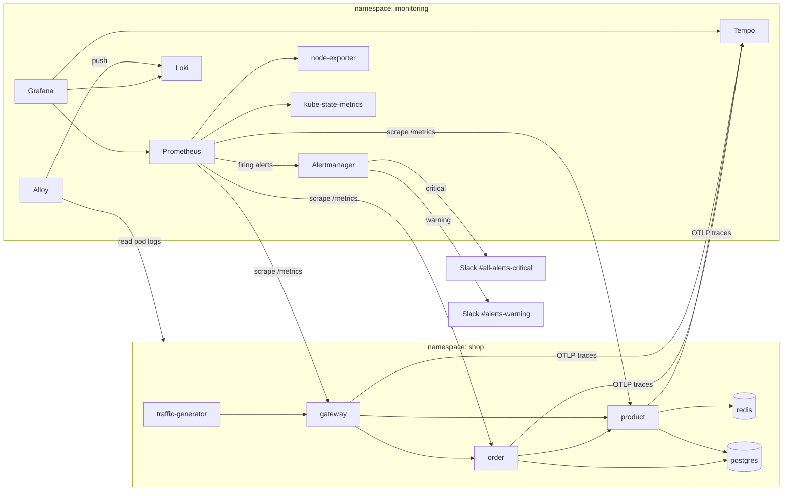

# Observability Platform for a Microservices App

Metrics, logs, traces, dashboards and alerts for a three-service Node.js shop, running on a local kind cluster.

| Pillar | Tool | Chart (version) |
|---|---|---|
| Metrics and alerting | Prometheus, Alertmanager, node-exporter, kube-state-metrics | kube-prometheus-stack 93.2.0 |
| Dashboards | Grafana | (part of kube-prometheus-stack) |
| Logs | Loki (single binary), collected by Alloy | loki 7.6.0, alloy 1.15.0 |
| Traces | Tempo (single binary), fed by OpenTelemetry | tempo 1.24.4 |

## Architecture



**How data flows**
- **Metrics:** each service publishes RED metrics at `/metrics` (prom-client). A ServiceMonitor tells Prometheus to scrape them every 15 seconds. node-exporter and kube-state-metrics supply node and cluster metrics.
- **Logs:** each service writes one JSON line per request (pino), including the trace ID. Alloy reads every pod's logs through the Kubernetes API and pushes them to Loki.
- **Traces:** OpenTelemetry auto-instrumentation is loaded before each app (`NODE_OPTIONS=--require ./tracing.js`) and sends spans to Tempo over OTLP/HTTP.
- **Alerts:** Prometheus evaluates the rules in `alerts/`. Alertmanager routes them to Slack by severity.

## Repository layout

| Path | Contents |
|---|---|
| `cluster/` | kind cluster definition (one node) |
| `helm/` | Helm values for the four charts |
| `k8s/namespaces.yaml` | `monitoring` and `shop` namespaces |
| `k8s/shop/` | App, data stores and traffic generator |
| `k8s/monitoring-servicemonitor.yaml` | Tells Prometheus which services to scrape |
| `k8s/dashboards/` | Dashboards packaged as ConfigMaps for provisioning |
| `dashboards/` | Dashboard JSON exports |
| `alerts/` | The five alert rules (PrometheusRule) |
| `runbooks/` | One runbook per alert |
| `app/` | Instrumented services (`tracing.js`, `observability.js`) |
| `screenshots/` | Numbered evidence |

## Setup

**Prerequisites:** Docker, kind, kubectl, Helm 3, a Slack workspace with two incoming webhooks. About 6 GB of free memory.

```bash
# 1. Cluster and namespaces
kind create cluster --config cluster/kind-config.yaml
kubectl apply -f k8s/namespaces.yaml

# 2. Secrets (typed in, never stored in Git)
read -s -p "Postgres password: " PGPW; echo
kubectl create secret generic postgres-credentials -n shop --from-literal=password="$PGPW"; unset PGPW
read -s -p "Grafana admin password: " GFPW; echo
kubectl create secret generic grafana-admin -n monitoring \
  --from-literal=admin-user=tomops --from-literal=admin-password="$GFPW"; unset GFPW
read -s -p "Critical webhook: " CRIT; echo
read -s -p "Warning webhook: " WARN; echo
kubectl create secret generic alertmanager-slack -n monitoring \
  --from-literal=critical-url="$CRIT" --from-literal=warning-url="$WARN"; unset CRIT WARN

# 3. Observability stack
helm repo add prometheus-community https://prometheus-community.github.io/helm-charts
helm repo add grafana https://grafana.github.io/helm-charts
helm repo update
helm install kps prometheus-community/kube-prometheus-stack --version 93.2.0 -n monitoring -f helm/kube-prometheus-stack-values.yaml
helm install loki grafana/loki --version 7.6.0 -n monitoring -f helm/loki-values.yaml
helm install alloy grafana/alloy --version 1.15.0 -n monitoring -f helm/alloy-values.yaml
helm install tempo grafana/tempo --version 1.24.4 -n monitoring -f helm/tempo-values.yaml

# 4. Build the instrumented images and load them into kind (no registry needed)
for svc in gateway product order; do
  docker build -t thormie/ecommerce-$svc:v1.1.1 app/$svc
  kind load docker-image thormie/ecommerce-$svc:v1.1.1 --name observability
done

# 5. App, scraping, dashboards, alerts and traffic
kubectl apply -f k8s/shop/data.yaml -f k8s/shop/services.yaml
kubectl apply -f k8s/monitoring-servicemonitor.yaml
kubectl apply -f k8s/dashboards/
kubectl apply -f alerts/
kubectl apply -f k8s/shop/traffic-generator.yaml
```

**Open Grafana:** `kubectl port-forward -n monitoring svc/kps-grafana 3030:80`, then http://localhost:3030 (user `tomops`). Filter dashboards by the **shop** tag.

## Dashboards

| Dashboard | Panels |
|---|---|
| Service Overview (RED) | Request rate, error rate (5xx only) with a 5% line, p99 latency with a 1 s line, per service |
| Infrastructure (Node) | CPU, memory, disk free on `/var`, network on `eth0` |
| Application Logs | Error count (last 5 minutes), log volume per service, recent errors and warnings |

## Alerts and routing

| Alert | Condition | Severity | Channel | Runbook |
|---|---|---|---|---|
| HighErrorRate | 5xx above 5% for 5 minutes | critical | #all-alerts-critical | [link](runbooks/high-error-rate.md) |
| HighLatencyP99 | p99 above 1 s for 5 minutes | warning | #alerts-warning | [link](runbooks/high-latency.md) |
| PodCrashLooping | more than 3 restarts in 1 hour | critical | #all-alerts-critical | [link](runbooks/pod-crash-looping.md) |
| NodeNotReady | node not Ready for 2 minutes | critical | #all-alerts-critical | [link](runbooks/node-not-ready.md) |
| DiskSpaceLow | under 10% free on `/var` for 5 minutes | warning | #alerts-warning | [link](runbooks/disk-space-low.md) |

**Routing rules:** alerts are grouped by alert name, namespace and service, so one incident sends one message. Repeats are limited to every 4 hours. A critical alert holds back the matching warning (inhibition). `Watchdog`, `InfoInhibitor` and `severity="info"` go to a null receiver. Resolved messages are sent too.

**Tested on November 11, 2026:** product was scaled to zero and a deliberately crashing pod was started. HighErrorRate, HighLatencyP99 and PodCrashLooping fired, reached Slack, and resolved after recovery (screenshots 21 to 25). NodeNotReady and DiskSpaceLow were not triggered for real: stopping the only node would also stop the monitoring, and filling a 1 TB disk is not sensible.

## Security

- **No default passwords:** Grafana's login (non-default username and password) comes from a Kubernetes Secret. `admin/admin` is rejected (screenshot 08).
- **No secrets in Git:** the Postgres password, Grafana login and Slack webhooks are typed in and stored only as Secrets. Alertmanager reads the webhooks from mounted files (`api_url_file`).
- **RBAC on Prometheus:** its service account can list pods but cannot delete pods or read Secrets (screenshot 26). Alloy's role is likewise read-only.
- **Least privilege in Slack:** the app has one scope, `incoming-webhook`.
- **Reduced attack surface:** Tempo accepts OTLP only; the Jaeger and Zipkin receivers are off.
- **Hardened images:** non-root user, no package managers in the runtime image (from the earlier hardening assignment).

## Design decisions

- **Namespace isolation:** the app (`shop`) and the tools (`monitoring`) are separate, so an app problem cannot disturb monitoring.
- **Resource limits on every component**, sized for a 16 GB laptop. Loki and Tempo run as single processes; Loki's multi-gigabyte caches are off.
- **Dashboards as code:** JSON files loaded by Grafana's provisioning sidecar, so a Grafana restart loses nothing.
- **Low cardinality:** metrics are labelled with route patterns (`/products/:id`), never raw URLs.
- **4xx are not errors:** a 404 means the client asked for something wrong; only 5xx count towards HighErrorRate.
- **Health and metrics requests are not traced or logged**, so traces and logs show only customer traffic.
- **nginx from the Compose version was dropped:** in Kubernetes the gateway is reached directly, and nginx would only cost memory.
- **Images are loaded with `kind load`** instead of pushed to Docker Hub, because of a slow connection. The Dockerfiles are in `app/` to rebuild them.

## Known limitations

- **Single node.** If it fails completely, NodeNotReady may never be sent. In production, Watchdog would feed an outside dead man's switch.
- **Node metrics show the WSL virtual machine,** not the whole Windows laptop. The 1 TB disk is WSL's maximum virtual size, stored on the C: drive.
- **Postgres uses temporary storage** (`emptyDir`). Data is lost if the pod is replaced; restart the traffic generator to reseed products.
- **Loki multi-tenancy is off** (`auth_enabled: false`). Only Grafana inside the cluster reaches it.
- **Duplicate crash alerts:** the chart's built-in KubePodCrashLooping (warning) also fires alongside PodCrashLooping (critical).

## Bonus

- **Trace-to-log correlation:** a "Logs for this trace" button on every trace opens the matching Loki lines (screenshot 14).

## Follow-ups

- `prom-client` is deprecated in favour of `@prometheus-io/client`; migrate when its API is confirmed.
- `npm audit` reports 7 vulnerabilities (1 high) in the new instrumentation packages; review and patch.
- Rotate the critical Slack webhook, which appeared in a setup screenshot.

## Evidence

| # | Shows |
|---|---|
| 01 to 05 | Cluster, namespaces, app running and responding |
| 06 to 07 | Grafana OOMKilled incident and the fix |
| 08 to 09 | Default login rejected, own login works |
| 10 to 15 | First logs, scraping, metrics and JSON logs, first trace, trace-to-log, health traces filtered |
| 16 to 19 | Traffic flowing and the three dashboards |
| 20 to 25 | Rules loaded, error spike, alerts firing, Slack critical and warning, resolved |
| 26 | Prometheus RBAC check |
